<h1>Hi, I am Ben! </h1>

   
  

I am Benedict, a Computer Science student with a huge passion for software development. Throughout the years I worked on various open-source projects such as Minecraft plugins, Mobile applications, Discord bots, FlipperZero apps, and many more to come!

## 🔒 `Cybersecurity`
[](https://github.com/benwoo1110/purposefully-malicious)
[](https://github.com/benwoo1110/CryptographyApp)
[](https://github.com/benwoo1110/cryptography-GUI)

[](https://github.com/benwoo1110/libprocesshider)

## `FlipperZero`

## `Minecraft Plugins`

[](https://github.com/benwoo1110/Multiverse-CommandDestination)
[](https://github.com/benwoo1110/Multiverse-Patches)

## `Discord Bot`
[](https://github.com/interactions-py/library)
[](https://github.com/NAFTeam/NAFF)

## `Web Development`
[](https://github.com/benwoo1110/SSD-Alkolq)

## `Mobile Applications`

[](https://github.com/benwoo1110/ExploreSST-ReactNative)

## `Windows Applications`
[](https://github.com/benwoo1110/COVID-Monitoring-System)
[](https://github.com/benwoo1110/CalculatorApp)

## `Games`
[](https://github.com/benwoo1110/Ratventure)

## `Other cool stuff`
[](https://github.com/benwoo1110/A-List-of-Sorts-v2)
[](https://github.com/benwoo1110/A-List-of-Sorts)
[](https://github.com/benwoo1110/testcase-maker)

## `Statistics`

